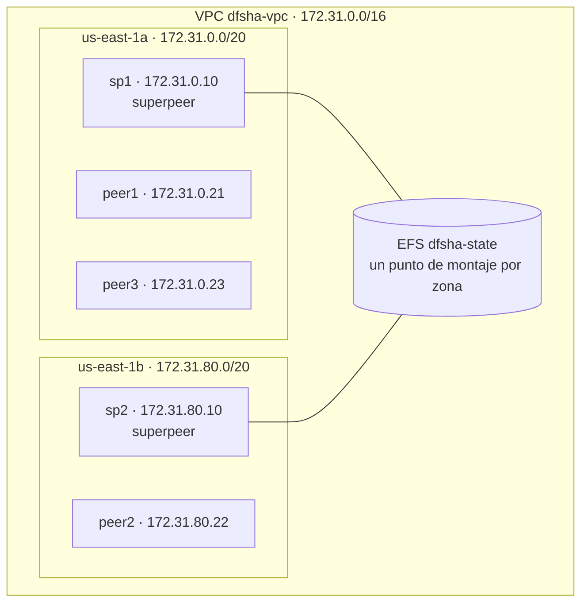

# Despliegue en AWS

Este documento describe el entorno de ejecución de DFSha en AWS Academy (Learner Lab) y el paso a paso para reproducirlo. Primero se describe cómo quedó desplegado el sistema (infraestructura, ejecución, ubicación de cada componente, almacenamiento, red y seguridad) y después se explica cómo levantarlo desde cero, con los mismos comandos que se usaron.

## 1. Descripción del entorno de ejecución

### 1.1 Infraestructura

El sistema se despliega en una cuenta de AWS Academy (Learner Lab), en la región `us-east-1`, dentro de una **VPC personalizada creada para el proyecto** (no se usa la VPC por defecto de la cuenta). La VPC tiene un bloque de direcciones `172.31.0.0/16` y dos subredes públicas, una en cada una de dos zonas de disponibilidad, para que la caída de una zona completa no tumbe todo el sistema. Las subredes salen a Internet a través de un Internet Gateway, y a cada instancia se le asigna una IP pública solo para poder entrar por SSH; los nodos se comunican entre sí únicamente con sus **IPs privadas**.

| Recurso | Cantidad | Detalle |
|---|---|---|
| VPC personalizada `dfsha-vpc` | 1 | `172.31.0.0/16`, con DNS habilitado |
| Subredes públicas | 2 | `dfsha-subnet-a` (`172.31.0.0/20`, `us-east-1a`) y `dfsha-subnet-b` (`172.31.80.0/20`, `us-east-1b`) |
| Internet Gateway | 1 | Asociado a la VPC, con ruta `0.0.0.0/0` desde ambas subredes |
| Máquinas virtuales (EC2) | 5 | 2 superpeers y 3 peers; sistema operativo Amazon Linux 2023; tipo `t3.small` (2 vCPU, 2 GB de memoria); disco de 20 GiB |
| Sistema de archivos EFS | 1 | `dfsha-state`, regional, con un punto de montaje en cada zona |
| Grupo de seguridad | 1 | `dfsha-sg`, compartido por las instancias y por los puntos de montaje del EFS |

La distribución en la red es la siguiente:



### 1.2 Cómo se ejecuta cada nodo: Docker

Todos los nodos se ejecutan en contenedores Docker, no de forma nativa. Una única definición, `deploy/Dockerfile`, sirve para los dos programas: es un Dockerfile de dos etapas que compila el programa en una imagen de Go y copia el binario resultante a una imagen mínima de Alpine, donde corre como un usuario sin privilegios (uid 10001). El argumento de construcción `CMD` indica cuál de los dos programas se compila (`superpeer` o `peer`), de modo que se obtienen dos imágenes, `dfsha-superpeer` y `dfsha-peer`. Las imágenes se construyen en cada instancia a partir del repositorio clonado, de manera que no hace falta un registro de imágenes.

En AWS cada contenedor se lanza con `docker run` en su propia máquina, a diferencia del entorno local, donde `docker compose` levanta los superpeers y cada peer se abre con `deploy/demo-peer.sh`. Los superpeers se lanzan en segundo plano y con reinicio automático (`--restart unless-stopped`). Los peers se lanzan en modo interactivo (`-it`), porque cada peer pide usuario y contraseña y ofrece la línea de comandos del usuario; el usuario entra a la máquina por SSH, o por la terminal web de AWS, y escribe allí los comandos.

### 1.3 Qué corre en cada máquina

| Nodo | Zona | IP privada | Contenedor | Puerto | Rol |
|---|---|---|---|---|---|
| sp1 | us-east-1a | 172.31.0.10 | `dfsha-superpeer` | 8080 (HTTPS) | Superpeer inicialmente líder |
| sp2 | us-east-1b | 172.31.80.10 | `dfsha-superpeer` | 8080 (HTTPS) | Superpeer en standby |
| peer1 | us-east-1a | 172.31.0.21 | `dfsha-peer` | 9000 (HTTPS con mTLS) | Peer, usuario `alice` |
| peer2 | us-east-1b | 172.31.80.22 | `dfsha-peer` | 9000 (HTTPS con mTLS) | Peer, usuario `alice` |
| peer3 | us-east-1a | 172.31.0.23 | `dfsha-peer` | 9000 (HTTPS con mTLS) | Peer, usuario `bob` |

El puerto 8080 de los superpeers atiende las operaciones de control (inicio de sesión, árbol de directorios, ubicación de los chunks, locks y heartbeats). El puerto 9000 de cada peer atiende la transferencia de chunks entre peers. Los usuarios `alice` y `bob` están dados de alta en el superpeer, y cada uno ve únicamente su propio árbol de directorios.

### 1.4 Almacenamiento

**Chunks de los peers.** Cada peer guarda los chunks en el disco de su propia instancia, sin ningún almacenamiento compartido. Dentro del contenedor la ruta es `/data/chunks`, que corresponde a la carpeta `~/data/chunks` de la máquina anfitriona (el contenedor monta `~/data` en `/data`). Cada chunk queda en `/data/chunks/<id-del-usuario>/<id-del-archivo>/<índice>`, y su contenido ya viene cifrado desde el peer dueño del archivo. La carpeta `~/files` de la máquina se monta como `/files` y es el directorio de trabajo del peer: ahí se dejan los archivos que se suben con `put` y caen los que se bajan con `get`.

**Estado compartido de los superpeers.** Los dos superpeers comparten una carpeta que reside en el sistema de archivos EFS. Cada uno monta el EFS en `/mnt/efs` y el contenedor monta `/mnt/efs/dfsha-state` en `/data`, que es el valor de la variable `STATE_DIR`. En esa carpeta el superpeer líder guarda dos archivos: `state.json`, con una instantánea del estado del sistema (usuarios, árbol de directorios, ubicación de los chunks, peers y locks) que se actualiza cada 2 segundos, y `leader.json`, el lease del líder que se renueva continuamente. Si el líder deja de renovarlo durante unos 15 segundos, el standby toma el mando y carga `state.json`. El EFS es regional y está cifrado en reposo, y cada instancia accede a él por el punto de montaje de su propia zona.

### 1.5 Red y seguridad

**Grupo de seguridad `dfsha-sg`.** Se usa un único grupo para todas las instancias y para los puntos de montaje del EFS:

| Dirección | Puerto | Origen | Para qué |
|---|---|---|---|
| Entrada | 22 (SSH) | La IP del administrador | Acceso a las instancias |
| Entrada | Todo el tráfico TCP | El propio `dfsha-sg` | Comunicación entre los nodos: 8080 (superpeers), 9000 (peers) y 2049 (NFS del EFS) |
| Salida | Todo | Cualquiera | Descarga de paquetes, imágenes y código |

**Cifrado de las comunicaciones.** El sistema usa una autoridad certificadora propia, generada con `deploy/certs/gen-certs.sh`, que firma un certificado por nodo con la IP privada de ese nodo como nombre alternativo. TLS es obligatorio en todos los nodos (el superpeer y el peer no arrancan sin certificado). La conexión entre un peer y un superpeer usa TLS en el que el peer verifica al superpeer, y cada petición lleva un token JWT firmado. La comunicación entre peers usa TLS mutuo (mTLS): cada peer exige a quien se conecta a su puerto 9000 un certificado firmado por la misma autoridad. Los certificados incluyen los usos de servidor y de cliente para que esto sea posible.

### 1.6 Cómo se levanta

El procedimiento completo está en la sección siguiente. En resumen: se crean la VPC, el grupo de seguridad, el EFS y las cinco instancias; se monta el EFS en los dos superpeers; se generan los certificados en la computadora del desplegador y se copian a cada nodo; se construye la imagen de cada nodo; y se lanzan primero los superpeers y después los peers.

## 2. Paso a paso

### Fase 0: preparación

1. Descargar la llave de acceso (`labsuser.pem`) desde *AWS Details* y guardarla en el sistema de archivos de Linux (por ejemplo, en `~/labsuser.pem`), con permisos `chmod 600 ~/labsuser.pem`.
2. Elegir las IPs privadas de los nodos. Dentro del rango de cada subred las cuatro primeras direcciones están reservadas por AWS (`.0` a `.3`), por eso las IPs empiezan más arriba:

| Nodo | Subred | IP privada |
|---|---|---|
| sp1 | `dfsha-subnet-a` | 172.31.0.10 |
| sp2 | `dfsha-subnet-b` | 172.31.80.10 |
| peer1 | `dfsha-subnet-a` | 172.31.0.21 |
| peer2 | `dfsha-subnet-b` | 172.31.80.22 |
| peer3 | `dfsha-subnet-a` | 172.31.0.23 |

### Fase 1: crear la VPC personalizada

En la consola, en el servicio **VPC**:

1. **Crear la VPC** (*Your VPCs → Create VPC → VPC only*): nombre `dfsha-vpc`, bloque IPv4 `172.31.0.0/16`. Después, en *Actions → Edit VPC settings*, activar *Enable DNS resolution* y *Enable DNS hostnames* (el EFS se resuelve por nombre DNS dentro de la VPC).
2. **Crear las dos subredes** (*Subnets → Create subnet*), en la VPC `dfsha-vpc`:
   - `dfsha-subnet-a`: zona `us-east-1a`, bloque `172.31.0.0/20`.
   - `dfsha-subnet-b`: zona `us-east-1b`, bloque `172.31.80.0/20`.
   En cada una, *Actions → Edit subnet settings → Enable auto-assign public IPv4 address*.
3. **Crear el Internet Gateway** (*Internet gateways → Create*): nombre `dfsha-igw`, y asociarlo a `dfsha-vpc` con *Actions → Attach to VPC*.
4. **Crear la tabla de rutas** (*Route tables → Create route table*): nombre `dfsha-rt`, VPC `dfsha-vpc`. Agregar la ruta `0.0.0.0/0` con destino `dfsha-igw` y, en *Subnet associations*, asociar las dos subredes.

### Fase 2: grupo de seguridad

En **EC2 → Security Groups → Create security group**: nombre `dfsha-sg`, VPC `dfsha-vpc`. Reglas de entrada:

- SSH, puerto 22, origen *My IP*.
- Todo el tráfico TCP, origen el propio grupo `dfsha-sg` (se agrega después de crear el grupo, editando sus reglas).

La regla de salida por defecto (todo el tráfico) se deja como está.

### Fase 3: sistema de archivos EFS

En **EFS → Create file system → Customize**: nombre `dfsha-state`, tipo regional, VPC `dfsha-vpc`. En los puntos de montaje se crea uno en `us-east-1a` y otro en `us-east-1b`, con la subred correspondiente y el grupo de seguridad `dfsha-sg` en ambos. Si el grupo de seguridad de algún punto de montaje queda con el predeterminado de la VPC, hay que cambiarlo a `dfsha-sg`, porque de lo contrario el montaje se queda esperando. Al terminar, anotar el identificador del sistema de archivos (`fs-…`).

### Fase 4: lanzar las cinco instancias

En **EC2 → Launch instance**, una vez por nodo:

- Nombre: el del nodo (`sp1`, `sp2`, `peer1`, `peer2`, `peer3`).
- Imagen (AMI): Amazon Linux 2023. Tipo: `t3.small`. Par de llaves: `vockey`.
- *Network settings → Edit*: VPC `dfsha-vpc`; subred la que corresponda según la tabla de la Fase 0; *Auto-assign public IP*: habilitado; grupo de seguridad existente `dfsha-sg`. En *Advanced network configuration*, en *Primary IP*, escribir la IP privada de la tabla.
- Almacenamiento: 20 GiB.
- *Advanced details → User data*:

```bash
#!/bin/bash
dnf install -y docker git amazon-efs-utils
systemctl enable --now docker
usermod -aG docker ec2-user
mkdir -p /mnt/efs
```

Cuando las cinco instancias estén en estado *Running*, anotar la IP pública de cada una (sirve solo para entrar por SSH). Para conectarse se puede usar SSH con la llave (`ssh -i ~/labsuser.pem ec2-user@<ip-pública>`) o *EC2 Instance Connect* desde la consola. Tras la primera conexión hay que cerrar la sesión y abrir otra para que el usuario pertenezca al grupo `docker`.

### Fase 5: montar el EFS (en sp1 y sp2)

En **sp1** y en **sp2**, con el identificador del EFS:

```bash
sudo mount -t efs fs-XXXXXXXX:/ /mnt/efs
echo "fs-XXXXXXXX:/ /mnt/efs efs _netdev,noresvport 0 0" | sudo tee -a /etc/fstab
df -h /mnt/efs
```

La segunda línea hace que el montaje se repita al reiniciar la instancia. Para comprobar que la carpeta es realmente compartida, en sp1 se escribe un archivo con `echo hola | sudo tee /mnt/efs/prueba.txt` y en sp2 se lee con `cat /mnt/efs/prueba.txt`, que debe mostrar `hola`. Después, en uno solo de los dos superpeers, se crea la carpeta del estado y se le da el dueño con que corre el contenedor:

```bash
sudo mkdir -p /mnt/efs/dfsha-state
sudo chown 10001:10001 /mnt/efs/dfsha-state
sudo rm /mnt/efs/prueba.txt
```

### Fase 6: certificados (en la computadora del desplegador)

Desde la carpeta del repositorio, con las IPs privadas de la Fase 0:

```bash
CERTS_DIR=deploy/certs/out-aws bash deploy/certs/gen-certs.sh \
  sp1=172.31.0.10,localhost,127.0.0.1 sp2=172.31.80.10,localhost,127.0.0.1 \
  peer1=172.31.0.21 peer2=172.31.80.22 peer3=172.31.0.23
```

El script crea la autoridad certificadora y un certificado y una clave por nodo en `deploy/certs/out-aws/` (carpeta que no se sube al repositorio). Los superpeers incluyen además `localhost` para poder comprobar su estado desde la propia máquina. Las IPs que se escriben aquí deben ser exactamente las que se asignaron a las instancias, porque los nodos comprueban que la dirección a la que se conectan coincida con la del certificado.

Se genera también el secreto de los tokens, que se guarda aparte y se usará en los dos superpeers:

```bash
openssl rand -hex 32
```

A cada nodo se le copian únicamente sus archivos más `ca.crt`; la clave `ca.key` no se copia a ninguna instancia. Ejemplo para sp1 (se repite con cada nodo, cambiando el nombre de los archivos y la IP pública):

```bash
KEY=~/labsuser.pem
CERTS=deploy/certs/out-aws
ssh -i $KEY ec2-user@<IP_PÚBLICA_SP1> 'mkdir -p ~/certs'
scp -i $KEY $CERTS/sp1.crt $CERTS/sp1.key $CERTS/ca.crt ec2-user@<IP_PÚBLICA_SP1>:~/certs/
ssh -i $KEY ec2-user@<IP_PÚBLICA_SP1> 'chmod 644 ~/certs/*'
```

Si la llave y los certificados están en sistemas de archivos distintos (por ejemplo, en Windows con WSL), la ruta de los certificados se escribe desde WSL como `/mnt/c/...`.

### Fase 7: construir las imágenes (en cada instancia)

En cada instancia, ya conectado por SSH:

```bash
git clone https://github.com/dsalazar444/dfsha.git
cd dfsha
```

En sp1 y sp2:

```bash
docker build -f deploy/Dockerfile --build-arg CMD=superpeer -t dfsha-superpeer .
```

En los tres peers:

```bash
docker build -f deploy/Dockerfile --build-arg CMD=peer -t dfsha-peer .
```

### Fase 8: levantar los superpeers

Primero sp1 y, cuando responda, sp2. El valor de `SESSION_SECRET` es el generado en la Fase 6 y debe ser idéntico en los dos. En **sp1**:

```bash
docker run -d --name sp --restart unless-stopped -p 8080:8080 \
  -e PORT=8080 -e STATE_DIR=/data -e SUPERPEER_ID=sp1 \
  -e SESSION_SECRET=<SECRETO_DE_LA_FASE_6> \
  -e REPLICATION_FACTOR=2 -e HEARTBEAT_TIMEOUT_SECONDS=15 \
  -e TLS_CERT=/certs/server.crt -e TLS_KEY=/certs/server.key -e PEER_SCHEME=https \
  -v /mnt/efs/dfsha-state:/data \
  -v ~/certs/sp1.crt:/certs/server.crt:ro -v ~/certs/sp1.key:/certs/server.key:ro \
  dfsha-superpeer
```

En **sp2** es el mismo comando con `SUPERPEER_ID=sp2` y los archivos `sp2.crt` y `sp2.key`. Cada superpeer debe tener un `SUPERPEER_ID` distinto. Al arrancar aparece un aviso de que `AES_KEY` no está definida; es inofensivo, porque esa clave no se usa en el código actual.

Para comprobar el rol de cada uno, desde la propia máquina:

```bash
curl -s -D - -o /dev/null --cacert ~/certs/ca.crt https://localhost:8080/health | grep -i x-superpeer-role
```

sp1 debe responder `leader` y sp2 `standby`.

### Fase 9: levantar los peers

En cada peer se crean las carpetas de datos y de trabajo, y se lanza el contenedor en modo interactivo. El peer publica el puerto 9000 de la máquina (`-p 9000:9000`) porque los demás peers llegan a él por la IP de la instancia. En **peer1**:

```bash
mkdir -p ~/data ~/files && sudo chown 10001:10001 ~/data ~/files
docker run -it --rm --name peer -p 9000:9000 \
  -e SUPERPEER_URLS=https://172.31.0.10:8080,https://172.31.80.10:8080 \
  -e PEER_ADDRESS=172.31.0.21 -e PEER_PORT=9000 \
  -e STORAGE_PATH=/data/chunks \
  -e TLS_CERT=/certs/server.crt -e TLS_KEY=/certs/server.key -e TLS_CA=/certs/ca.crt -e ALLOW_INSECURE=false \
  -v ~/data:/data -v ~/files:/files -w /files \
  -v ~/certs/peer1.crt:/certs/server.crt:ro -v ~/certs/peer1.key:/certs/server.key:ro -v ~/certs/ca.crt:/certs/ca.crt:ro \
  dfsha-peer
```

En **peer2** se cambian `PEER_ADDRESS=172.31.80.22` y los archivos `peer2.crt` y `peer2.key`; en **peer3**, `PEER_ADDRESS=172.31.0.23` y `peer3.crt` y `peer3.key`. Cada peer pide usuario y contraseña: `alice` / `alice1234` en peer1 y peer2, y `bob` / `bob1234` en peer3. Debe aparecer `logged in as <usuario>`, `serving chunks on port 9000` y el prompt `dfsha:/>`. El `PEER_ADDRESS` de cada peer es su propia IP privada, y es la dirección con la que se registra en el superpeer y con la que los demás peers lo contactan.

### Fase 10: apagar y volver a encender

Para no gastar créditos, las instancias se detienen (*Stop*), no se terminan: detenerlas conserva su IP privada, su disco y sus certificados, de modo que al volver a arrancarlas el sistema funciona con la misma configuración. El EFS conserva su contenido. Al volver a arrancar, los superpeers se reinician solos (`--restart unless-stopped`) y el EFS se vuelve a montar por `/etc/fstab`; los peers hay que abrirlos de nuevo con el comando de la Fase 9. Las IPs públicas cambian en cada arranque, así que hay que consultar las nuevas en la consola para el SSH.


## 3. Diferencias con el entorno local

| Aspecto | Local (`docker compose`) | AWS |
|---|---|---|
| Cómo se levanta cada nodo | `docker compose` para los superpeers y `deploy/demo-peer.sh` para los peers | `docker run` en cada instancia |
| Red | Red de Docker en una sola máquina; los nodos se llaman por nombre (`sp1`, `peer1`) | VPC personalizada con dos zonas; los nodos se llaman por IP privada |
| Carpeta compartida de los superpeers | Volumen de Docker | EFS montado en `/mnt/efs` |
| Certificados | Con nombres de servicio (`sp1`, `peer1`) y `localhost` | Con la IP privada de cada nodo |
| Puertos de los peers | Visibles solo dentro de la red de Docker | Publicados en la máquina con `-p 9000:9000` |
| Imágenes | Construidas por el compose | Construidas en cada instancia a partir del repositorio |
