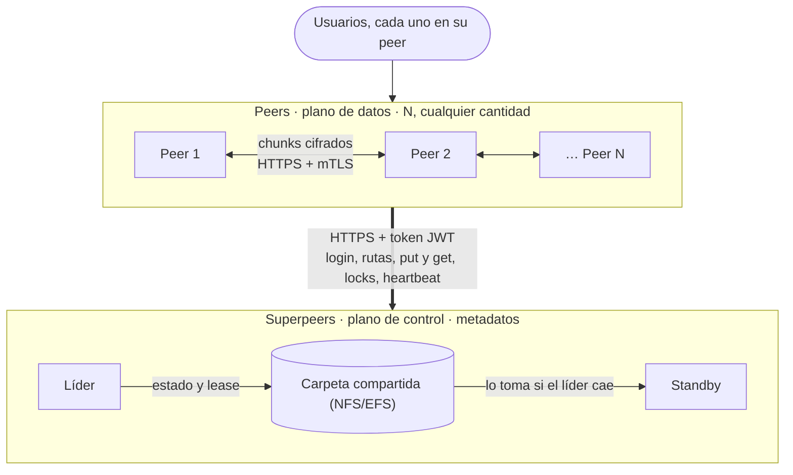

# DFSha

Sistema de archivos distribuido peer-to-peer escrito en Go. Cada usuario ve un árbol de directorios único (`mkdir`, `cd`, `ls`, `put`, `get`, `rm`, …), pero sus archivos viven partidos en pedazos (*chunks*), cifrados y replicados en varios peers. Un par de superpeers coordina el sistema, y un peer se puede caer sin que se pierda ningún archivo.

## Índice

1. [Cómo funciona](#1-cómo-funciona)
   - [Componentes](#componentes)
   - [Arquitectura](#arquitectura)
   - [Qué pasa al subir un archivo](#qué-pasa-al-subir-un-archivo-put)
   - [Qué pasa al bajarlo](#qué-pasa-al-bajarlo-get)
   - [Qué pasa cuando algo falla](#qué-pasa-cuando-algo-falla)
   - [Seguridad](#seguridad)
2. [Estructura del repositorio](#2-estructura-del-repositorio)
3. [Reproducirlo en local](#3-reproducirlo-en-local)
   - [Requisitos](#requisitos)
   - [Paso 1: certificados](#paso-1-certificados)
   - [Paso 2: levantar los superpeers](#paso-2-levantar-los-superpeers)
   - [Paso 3: probar la línea de comandos a mano](#paso-3-probar-la-línea-de-comandos-a-mano)
   - [Comandos de la línea de comandos](#comandos-de-la-línea-de-comandos)
   - [Variables de configuración](#variables-de-configuración)
4. [Despliegue en AWS](#4-despliegue-en-aws)
5. [Documentos](#5-documentos)

## 1. Cómo funciona

### Componentes

| Componente | Qué hace |
|---|---|
| **Superpeer** | El plano de control. Autentica usuarios, guarda el árbol de directorios de cada uno, sabe en qué peers está cada chunk, vigila qué peers están vivos, reparte los locks y ordena las replicaciones. **No mueve ningún dato de archivos.** |
| **Superpeer en standby** | Un segundo superpeer que comparte con el primero una carpeta (`STATE_DIR`). Si el líder se cae, toma el mando en unos 15–21 s. |
| **Peer** | Un programa que hace dos cosas: **guarda chunks** de otros usuarios (servidor HTTPS en el puerto 9000) y le da a su usuario una **línea de comandos** (`dfsha:/>`). |
| **CA y certificados** | Una autoridad certificadora propia (`deploy/certs/gen-certs.sh`) firma un certificado por nodo. Con ellos todo viaja por TLS. |

### Arquitectura



### Qué pasa al subir un archivo (`put`)
1. El peer pide la contraseña, inicia sesión en el superpeer y recibe un token y una *sal*. Con ellas deriva su clave maestra (Argon2id). **La clave nunca sale del peer ni se guarda.**
2. Parte el archivo en chunks (64 MiB por defecto), cifra cada uno con AES-GCM usando una clave propia del archivo y calcula el SHA-256 de cada chunk cifrado.
3. Envía al superpeer la ruta, el `file_id` y los hashes (`put/init`). El superpeer anota el archivo en el árbol del usuario y contesta **a qué peers va cada chunk** (factor de replicación 2 por defecto).
4. El peer manda cada chunk directamente a esos peers. Cada peer que lo recibe verifica el hash, lo guarda y avisa al superpeer (`put/ack`).

### Qué pasa al bajarlo (`get`)
El peer le pregunta al superpeer dónde están los chunks (solo le contesta con peers vivos que ya confirmaron tenerlo), los pide a los peers, comprueba cada hash **contra el que dio el superpeer**, los descifra y los une. Un peer que sirve un chunk corrupto o falso es descartado y se prueba con otra réplica.

### Qué pasa cuando algo falla
- **Se cae un peer.** Los peers mandan un *heartbeat* cada 10 s con la lista de chunks que tienen. Si un peer calla 15 s, el superpeer lo da por caído. En la respuesta al siguiente heartbeat de los demás les ordena copiar los chunks que quedaron con menos de 2 réplicas. Si el peer vuelve con sus datos, se reincorpora.
- **Se cae el superpeer líder.** El líder renueva cada pocos segundos un archivo `leader.json` en la carpeta común, y guarda el estado en `state.json`. Si deja de renovarlo, el standby toma el mando con ese estado. Las sesiones siguen valiendo porque los tokens (JWT) se firman con una clave compartida. El superpeer que no es líder contesta `421`, y los peers pasan al otro tras 3 fallos seguidos.
- **Dos usuarios editan lo mismo.** `lock` / `unlock` dan exclusión mutua sobre un archivo. El lock dura 30 s y el CLI lo renueva mientras lo tiene; si el peer que lo tiene se cae, caduca solo.
- **Borrar.** `rm` quita el archivo del árbol al instante, y el superpeer ordena en los heartbeats borrar los chunks de cada peer hasta que desaparecen.

### Seguridad
| Capa | Qué hay |
|---|---|
| Comunicaciones | **TLS obligatorio** entre todos los nodos, con nuestra CA. Sin certificados, el superpeer y el peer no arrancan (salvo `ALLOW_INSECURE=true`, solo para desarrollo). |
| Entre peers | **mTLS** en el puerto de datos: un peer solo acepta clientes con un certificado firmado por la CA. |
| Usuarios | Usuario y contraseña, y un token JWT (HS256) en cada petición al superpeer. Cada usuario ve solo su árbol de directorios. |
| Almacenamiento | Los chunks están cifrados (AES-GCM) antes de salir del peer dueño. Los peers que los guardan solo ven bytes cifrados. |

## 2. Estructura del repositorio

```
cmd/superpeer/        programa del superpeer
cmd/peer/             programa del peer (servidor de chunks + línea de comandos)
internal/superpeer/   auth, árbol de directorios, archivos, peers, locks, líder y persistencia
internal/peer/        almacenamiento, servidor, cliente, transferencia, cifrado, CLI, heartbeat
internal/shared/      modelo de datos común y configuración de TLS (tlsconf)
deploy/               Dockerfile, docker-compose, certificados y scripts de prueba
superpeer-openapi.yaml, peer-openapi.yaml    contratos de las dos APIs
docs/despliegueaws.md  guía de despliegue en AWS (pendiente)
```

## 3. Reproducirlo en local

Todo corre en contenedores: **2 superpeers y 3 peers**, con TLS, en una sola máquina. Los superpeers los levanta `docker compose` y cada peer se abre en su propia terminal.

### Requisitos
- **Docker** (en Windows, Docker Desktop abierto y corriendo).
- **bash** para los scripts de `deploy/`:
  - En **Windows**, Git Bash, ya trae `openssl`.
  - En **Linux**, `bash` y **`openssl`** instalado.

### Paso 1: certificados
```bash
bash deploy/certs/gen-certs.sh
```
Crea la CA y un certificado por nodo en `deploy/certs/out/` (esa carpeta no se sube a git). Si ya existe una CA se reutiliza. Hay que correrlo antes de levantar el compose.

### Paso 2: levantar los superpeers
```bash
docker compose -f deploy/docker-compose.yml up -d --build sp1 sp2
docker ps --format '{{.Names}} {{.Status}}'
```
Deben aparecer `dfsha-sp1` y `dfsha-sp2` como `healthy` (tarda unos 20 s). Para ver quién es el líder:
```bash
curl -si --ssl-no-revoke --cacert deploy/certs/out/ca.crt https://localhost:8081/health | grep -i x-superpeer-role   # leader
curl -si --ssl-no-revoke --cacert deploy/certs/out/ca.crt https://localhost:8082/health | grep -i x-superpeer-role   # standby
```
(`--ssl-no-revoke` solo hace falta con el `curl` de Windows; en Linux no hace nada.)

### Paso 3: probar la línea de comandos a mano

Se usan **cuatro terminales**. En Windows, son cuatro Git Bash abiertas en la carpeta del repositorio.

| Terminal | Para qué sirve | Comando |
|---|---|---|
| **T0** | Control: crear el archivo de prueba, comprobar resultados y matar nodos | no abre ningún peer: se usa solo cuando un ejemplo lo pide |
| **T1** | peer1, usuario `alice` / `alice1234` | `bash deploy/demo-peer.sh peer1` |
| **T2** | peer2, usuario `alice` / `alice1234` | `bash deploy/demo-peer.sh peer2` |
| **T3** | peer3, usuario `alice` / `alice1234` | `bash deploy/demo-peer.sh peer3` |

Antes de empezar, abre los tres peers (T1, T2 y T3), cada uno en su terminal.

Cada peer:

- pide usuario y contraseña (los usuarios están dados de alta en el superpeer) y muestra el prompt `dfsha:/>`;
- usa como carpeta de trabajo `deploy/demo-files/<peer>/`: ahí se dejan los archivos que se quieren subir y ahí caen los que se bajan;
- construye su imagen de Docker solo la primera vez. Si cambias el código, reconstrúyela con `docker build -f deploy/Dockerfile --build-arg CMD=peer -t dfsha-peer .`


#### Ejemplo 1: subir en un peer y bajar en otro

Muestra la transparencia: el peer que baja el archivo nunca escribe la dirección de nadie. El superpeer le dice dónde está cada chunk.

| Paso | Terminal | Comando | Debes ver |
|---|---|---|---|
| 1 | T0 | `mkdir -p deploy/demo-files/peer1` | — |
| 2 | T0 | `printf 'Informe de prueba de DFSha\nlinea dos\n' > deploy/demo-files/peer1/informe.txt` | — |
| 3 | T1 | `mkdir docs` | — |
| 4 | T1 | `cd docs` | el prompt pasa a `dfsha:/docs>` |
| 5 | T1 | `put informe.txt` | `uploaded /docs/informe.txt (37 bytes, id …)` |
| 6 | T2 | `ls /docs` | `informe.txt` |
| 7 | T2 | `get /docs/informe.txt copia.txt` | `downloaded /docs/informe.txt -> copia.txt (37 bytes)` |
| 8 | T0 | `cat deploy/demo-files/peer2/copia.txt` | el mismo texto del paso 2 |

#### Ejemplo 2: locks

Un lock impide que otro peer bloquee el mismo archivo. Dura 30 s en el superpeer, pero el CLI lo renueva mientras lo tiene.

| Paso | Terminal | Comando | Debes ver |
|---|---|---|---|
| 1 | T1 | `lock /docs/informe.txt` | `locked /docs/informe.txt (until unlock or exit)` |
| 2 | T2 | `lock /docs/informe.txt` | `error: conflict: it already exists or is locked by someone else (HTTP 409 …)` |
| 3 | T1 | `unlock /docs/informe.txt` | `unlocked /docs/informe.txt` |
| 4 | T2 | `lock /docs/informe.txt` | `locked /docs/informe.txt …` (ahora sí) |
| 5 | T2 | `unlock /docs/informe.txt` | `unlocked /docs/informe.txt` |

Si esperas más de 30 s entre los pasos 1 y 2, T2 sigue recibiendo conflicto: T1 renovó el lock.

#### Ejemplo 3: se cae un peer

Muestra que un archivo sigue disponible aunque un peer se caiga, porque cada chunk tiene otra copia.

| Paso | Terminal | Comando | Debes ver |
|---|---|---|---|
| 1 | T1 | `put informe.txt /docs/otro.txt` | `uploaded /docs/otro.txt (…)` |
| 2 | T0 | `docker kill dfsha-peer3` | — |
| 3 | — | espera unos 25 s | el superpeer da por caído a peer3 y re-replica lo que tenía |
| 4 | T2 | `get /docs/otro.txt otro.txt` | `downloaded /docs/otro.txt -> otro.txt (…)` |

#### Ejemplo 4: se cae el superpeer líder y el standby lo sustituye

Muestra que el sistema sigue funcionando cuando se cae el superpeer líder, sin volver a iniciar sesión.

| Paso | Terminal | Comando | Debes ver |
|---|---|---|---|
| 1 | T0 | `docker compose -f deploy/docker-compose.yml kill sp1` | — |
| 2 | T1 y T2 | espera unos 20 s | líneas de log del peer (ver abajo) |
| 3 | T0 | el `curl` del puerto 8082 del Paso 2 | `X-Superpeer-Role: leader` |
| 4 | T1 y T2 | `ls /docs` | `informe.txt` y `otro.txt` |
| 5 | T0 | `docker compose -f deploy/docker-compose.yml start sp1` | — |
| 6 | T0 | los dos `curl` del Paso 2 (puertos 8081 y 8082) | sp1 en `standby` y sp2 en `leader` |

Durante la espera del paso 2, T1 y T2 muestran líneas como éstas. Es lo esperado: el peer va probando y cambia de superpeer.

```
heartbeat to https://sp1:8080 failed (1/3): superpeer unavailable ...
switching superpeer: https://sp1:8080 -> https://sp2:8080
heartbeat to https://sp2:8080 failed (1/3): ... HTTP 421: this superpeer is on standby ...
```

Si escribes un comando antes de que termine el cambio, el CLI dice `superpeer unreachable; try again…`. Espera unos segundos y repite.

#### Al terminar

1. Escribe `exit` en T1, T2 y T3.
2. En **T0**, borra todo:

```bash
docker compose -f deploy/docker-compose.yml down -v
docker volume rm dfsha-peer1-data dfsha-peer2-data dfsha-peer3-data
rm -rf deploy/demo-files
```

El `docker volume rm` es necesario: los datos de los peers abiertos a mano viven en volúmenes que `down -v` no borra.

### Comandos de la línea de comandos
| Comando | Qué hace |
|---|---|
| `pwd`, `cd [ruta]`, `ls [ruta]` | Navegar el árbol de directorios |
| `mkdir <ruta>`, `rmdir <ruta>` | Crear y borrar directorios (`rmdir` borra también los archivos de dentro) |
| `put <local> [remoto]` | Subir un archivo (máximo 200 MiB) |
| `get <remoto> [local]` | Bajar un archivo (no sobrescribe) |
| `rm <ruta>` | Borrar un archivo |
| `lock <ruta>` / `unlock <ruta>` | Bloquear y desbloquear un archivo; el CLI renueva el lock mientras lo tiene |
| `mdf <ruta>` | Editar un archivo en `$EDITOR`: lo bloquea, lo baja, abre el editor y sube el resultado solo si cambió |
| `login` | Volver a iniciar sesión cuando la sesión caducó |
| `help`, `exit` | Ayuda y salir |

Las rutas con espacios van entre comillas, y las relativas parten del directorio actual.

### Variables de configuración

**Superpeer**

| Variable | Qué es | Por defecto |
|---|---|---|
| `PORT` | Puerto | `8080` |
| `STATE_DIR` | Carpeta compartida del estado. Vacía: sin standby | vacío |
| `SUPERPEER_ID` | Nombre del superpeer; debe ser distinto en cada uno | el hostname |
| `SESSION_SECRET` | Clave (64 hex) con que se firman los tokens; **igual en los dos superpeers** | clave de desarrollo, con aviso |
| `REPLICATION_FACTOR` | Copias de cada chunk | `2` |
| `HEARTBEAT_TIMEOUT_SECONDS` | Silencio tras el cual un peer se da por caído | `15` |
| `TLS_CERT`, `TLS_KEY` | Certificado y clave del superpeer | vacío |
| `ALLOW_INSECURE` | Permite HTTP plano si no hay certificado (solo desarrollo) | `false` |
| `PEER_SCHEME` | `http` o `https`: cómo se llega a los peers | `https` |

**Peer**

| Variable | Qué es | Por defecto |
|---|---|---|
| `SUPERPEER_URLS` | Lista de superpeers, separada por comas | obligatoria |
| `PEER_ADDRESS`, `PEER_PORT` | Nombre y puerto por el que los demás llegan a este peer | obligatorias |
| `STORAGE_PATH` | Carpeta donde se guardan los chunks | `./data` |
| `HEARTBEAT_INTERVAL` | Cada cuánto avisa que sigue vivo | `10s` |
| `CHUNK_SIZE` | Bytes por chunk al subir | `67108864` (64 MiB) |
| `PARALLELISM` | Transferencias de chunks simultáneas | `4` |
| `DFSHA_USERNAME` | Rellena el usuario en el inicio de sesión | vacío |
| `TLS_CERT`, `TLS_KEY` | Certificado y clave del peer | vacío |
| `TLS_CA` | Certificado de la CA; obligatorio si hay `TLS_CERT` | vacío |
| `ALLOW_INSECURE` | Permite HTTP plano (solo desarrollo) | `false` |

## 4. Despliegue en AWS

Ver [`docs/despliegueaws.md`](docs/despliegueaws.md). *Pendiente.*

## 5. Documentos
- [`superpeer-openapi.yaml`](superpeer-openapi.yaml) y [`peer-openapi.yaml`](peer-openapi.yaml): contratos de las APIs.
